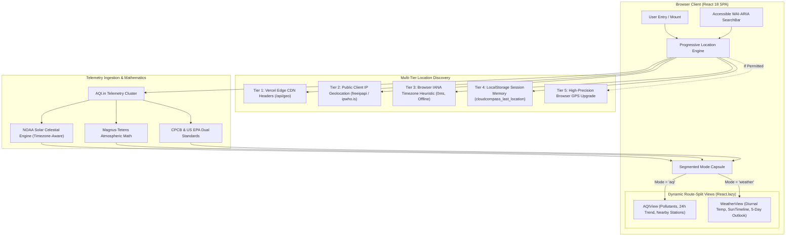

# CloudCompass | Real-Time Weather & Air Quality Platform

[](https://cloudcompass99.vercel.app/)
[](https://github.com/DevCodeHub99/cloud-compass/actions/workflows/ci.yml)
[](https://react.dev/)
[](https://vitejs.dev/)
[](https://tailwindcss.com/)
[](https://opensource.org/licenses/MIT)

**CloudCompass** is an environmental intelligence application built with **React 18**, **Vite**, and **Tailwind CSS**. It provides real-time ground-level air quality telemetry and meteorological forecasts powered by a single, unified physical sensor network ([AQI.in](https://www.aqi.in)).

🔗 **Live Application**: [https://cloudcompass99.vercel.app/](https://cloudcompass99.vercel.app/)

---

## Architecture & System Overview



---

## Core Capabilities

### 1. Multi-Tier Progressive Location Discovery
- **Zero-Setup Regional Discovery**: Automatically determines the visitor's city and geographic coordinates on first load without demanding invasive permissions or defaulting to a hardcoded city.
- **Vercel Edge Integration ([`api/geo.js`](file:///api/geo.js))**: Reads `x-vercel-ip-city` and coordinates directly from connection headers at edge edge points with 0ms third-party latency.
- **Client IP & IANA Timezone Heuristic**: Falls back to CORS IP endpoints (`freeipapi.com`, `ipwho.is`) and browser timezone extraction (`Intl.DateTimeFormat`) for 100% offline coverage.
- **Smooth GPS Upgrade**: Prompts for device GPS in the background. When approved, seamlessly refines coordinates from broad city centers to the closest neighborhood physical sensor.
- **Session Memory**: Caches the active location to `localStorage` (`cloudcompass_last_location`) for instantaneous sub-millisecond restoration on subsequent visits.

### 2. Dual Environmental Operational Modes
- **Weather Forecast Mode**:
  - Live observation, diurnal high/low projections, feels-like temperature, and atmospheric advisory.
  - Continuous 24-hour temperature curve with solar rise and set markers.
  - **NOAA Solar Celestial Engine**: High-precision calculation of dawn, sunrise, solar noon, sunset, dusk, daylight duration, and real-time sun elevation trajectory, formatted according to target longitude timezone offsets.
  - 5-day outlook with horizontal temperature distribution range bars.
  - 6-card meteorological grid: UV index, Wind & Gusts, Humidity & Dew Point, Barometric Pressure, Visibility, and Cloud Cover.
- **Air Quality (AQI) Mode**:
  - Live dual-standard comparison between **Indian CPCB** (0–500) and **US EPA** scales.
  - Interactive 24-hour pollution histogram with frame-synced 60fps pointer scrubbing (`requestAnimationFrame`).
  - Active pollutant cards with status accents (PM2.5, PM10, TVOC, CO, Noise).
  - Nearest physical sensor discovery with Haversine distance calculation.
  - Real-time polluted cities leaderboard.

### 3. Production Performance & Optimization
- **Route-Level Code Splitting**: View containers (`WeatherView`, `AQIView`) are dynamically loaded via `React.lazy` and wrapped in `<Suspense>`.
- **Vendor Chunking**: External libraries (`react`, `react-dom`, `lucide-react`) are isolated into immutable Rollup vendor chunks for aggressive edge caching.
- **Micro-Bundle Footprint**: Initial application entry is reduced to **~17 kB** gzipped; total compressed JavaScript is **~80 kB** gzipped across all modules.
- **Component Memoization**: All leaf presentation components are wrapped in `React.memo` to eliminate unnecessary re-renders during state transitions.

### 4. Accessibility (a11y) & UX Standards
- **WAI-ARIA Combobox Search**: Full keyboard navigation (`ArrowDown`, `ArrowUp`, `Enter`, `Escape`) across autocomplete suggestions and search history.
- **Screen Reader Readiness**: Clear `aria-label`, `role="listbox"`, `role="option"`, and `aria-activedescendant` bindings across input controls and clear buttons.
- **FOUC Prevention**: Inline pre-hydration script in [`index.html`](file:///index.html) ensures zero Flash of Unstyled Content on theme hydration.

---

## Quick Start

### Prerequisites
- Node.js `18.x` or higher
- npm `9.x` or higher

### Installation
```bash
# 1. Clone repository
git clone https://github.com/DevCodeHub99/Weather-Forecast-Application.git
cd Weather-Forecast-Application

# 2. Install dependencies
npm install

# 3. Start development server
npm run dev
```
Open [http://localhost:3000](http://localhost:3000) in your browser.

### Production Build
```bash
# Build optimized static assets with code splitting
npm run build

# Preview production build locally
npm run preview
```

### Running Test Suite
```bash
# Execute native zero-dependency test suite
npm test
```

---

## Environment Configuration

CloudCompass is pre-configured with production-ready zero-configuration defaults and works immediately without any `.env` file.

To customize API endpoints or telemetry credentials, copy `.env.example` to `.env.local`:

```bash
cp .env.example .env.local
```

| Variable | Default Value | Description |
| :--- | :--- | :--- |
| `VITE_AQI_API_BASE` | `https://apiserver.aqi.in` | Base endpoint for the AQI.in telemetry cluster or custom reverse proxy |
| `VITE_AQI_TOKEN` | Pre-bundled bootstrap token | Optional custom or rotated JWT Bearer token for telemetry |
| `VITE_LOG_LEVEL` | `"warn"` (prod) / `"debug"` (dev) | Minimum logging threshold: `debug` \| `info` \| `warn` \| `error` \| `none` |

---

## Build Diagnostics & Bundle Distribution

```text
vite v6.4.6 building for production...
✓ 1606 modules transformed.
dist/index.html                        8.03 kB │ gzip:  2.71 kB
dist/assets/bg-img-D-nDYq9F.avif      64.50 kB
dist/assets/index-DN9aImng.css        60.49 kB │ gzip: 10.04 kB
dist/assets/icons-C-QR6h7-.js         22.79 kB │ gzip:  6.11 kB
dist/assets/WeatherView-CKKvyVTD.js   42.14 kB │ gzip:  9.40 kB
dist/assets/AQIView-BufGZgas.js       43.74 kB │ gzip:  9.77 kB
dist/assets/index-CwLqAQ0d.js         49.96 kB │ gzip: 17.46 kB
dist/assets/vendor-CbbLAKBo.js       134.66 kB │ gzip: 43.22 kB
✓ built in 5.44s
```

---

## Directory Tree

```
Weather-Forecast-Application/
├── .env.example                 # Standardized environment template
├── .gitignore                   # Git exclusion rules
├── index.html                   # HTML entrypoint with theme pre-hydration
├── package.json                 # Project dependencies and npm scripts
├── postcss.config.js            # PostCSS configuration
├── tailwind.config.js           # Tailwind theme and dark-mode setup
├── vercel.json                  # Edge routing, caching & API rewrites
├── vite.config.js               # Bundler configuration & vendor chunking
├── api/
│   └── geo.js                   # Vercel Edge CDN IP geolocation handler
└── src/
    ├── main.jsx                 # App root with ErrorBoundary wrapper
    ├── App.jsx                  # State orchestration & mode synchronization
    ├── index.css                # Global dual-theme styling & scrollbar hiding
    ├── img/
    │   └── bg-img.avif          # Optimized atmospheric backdrop image
    ├── constants/
    │   ├── api.js               # Endpoints, environment fallbacks & storage keys
    │   └── aqiStandards.js      # CPCB / US EPA bands, thresholds & formatting
    ├── utils/
    │   ├── logger.js            # Production structured logger & telemetry hooks
    │   ├── solarCalculator.js   # NOAA astronomical sunrise, sunset & solar elevation
    │   └── weatherUtils.js      # Dew point, UV scale, wind direction & comfort math
    ├── services/
    │   ├── aqiService.js        # AQI.in client, timeout abortion & geo math
    │   ├── weatherService.js    # Telemetry normalization & meteorological forecast
    │   └── locationDetection.js # Multi-tier Edge/IP/Timezone progressive location discovery
    ├── hooks/
    │   ├── useGeolocation.js    # Browser GPS hook with descriptive error codes
    │   └── useLocalStorage.js   # Persistent storage hook with in-memory fallback
    └── components/
        ├── common/
        │   ├── Header.jsx       # Branding & circular morphing theme toggle
        │   ├── SearchBar.jsx    # Accessible WAI-ARIA location search & history
        │   ├── Footer.jsx       # Responsive footer with attribution
        │   ├── Loader.jsx       # Adaptive dark/light telemetry loader
        │   └── ErrorBoundary.jsx# Fallback UI preventing white-screen crashes
        ├── aqi/
        │   ├── AQIView.jsx      # Lazy-loaded AQI mode container
        │   ├── AQIHero.jsx      # Master AQI card, spectrum slider & micro-weather
        │   ├── PollutantGrid.jsx# Active pollutant cards with status accents
        │   ├── TrendChart.jsx   # 24-hour interactive pollution bar histogram
        │   ├── NearbyStations.jsx# Closest physical monitoring stations list
        │   ├── SensorWeather.jsx# On-site meteorological observations
        │   └── TopPollutedCities.jsx # Live polluted cities leaderboard
        └── weather/
            ├── WeatherView.jsx        # Lazy-loaded Weather mode container
            ├── CurrentWeather.jsx     # Current observation & diurnal temperature
            ├── HourlyForecast.jsx     # 24-hour timeline with solar markers
            ├── SunTimeline.jsx        # Solar trajectory with real-time sun position
            ├── DailyForecast.jsx      # 5-day forecast with temperature range bars
            └── WeatherMetricsGrid.jsx # 6-card meteorological intelligence grid
```

---

## Observability & Error Tracking

CloudCompass features an enterprise logging and telemetry event bus ([`src/utils/logger.js`](file:///src/utils/logger.js)):

- **Global Error Handlers**: Automatically intercepts uncaught exceptions and unhandled promise rejections with URL, timestamp, and stack traces.
- **Pluggable APM Subscriptions**: Connect external monitoring tools (e.g., Sentry, Datadog, LogRocket) via zero-dependency hooks:
  ```javascript
  import { onError, onEvent } from "./utils/logger";

  // Forward exceptions to Sentry / Datadog
  onError((errorPayload) => {
    // Sentry.captureException(errorPayload.error, { extra: errorPayload.context });
  });

  // Forward user interactions to analytics
  onEvent((eventPayload) => {
    // analytics.track(eventPayload.name, eventPayload.data);
  });
  ```

---

## Architectural Principles

- **Single Source of Truth**: 100% of telemetry originates from physical sensors through `aqi.in`.
- **KISS & YAGNI**: Clean React 18 state management without external store bloat (~17 kB gzipped core bundle).
- **DRY Design**: Reusable hooks (`useLocalStorage`, `useGeolocation`), centralized mathematical utilities (`solarCalculator`, `weatherUtils`), and modular components.
- **Robust Error Handling**: Non-blocking `try/catch` fallbacks, request timeout abortion (`AbortController`), and user-facing error boundaries.
- **Repository Hygiene**: Version control remains free of build outputs (`dist/`), temporary scripts, or local secret files.

---

## License

This project is open-source and distributed under the [MIT License](LICENSE).
